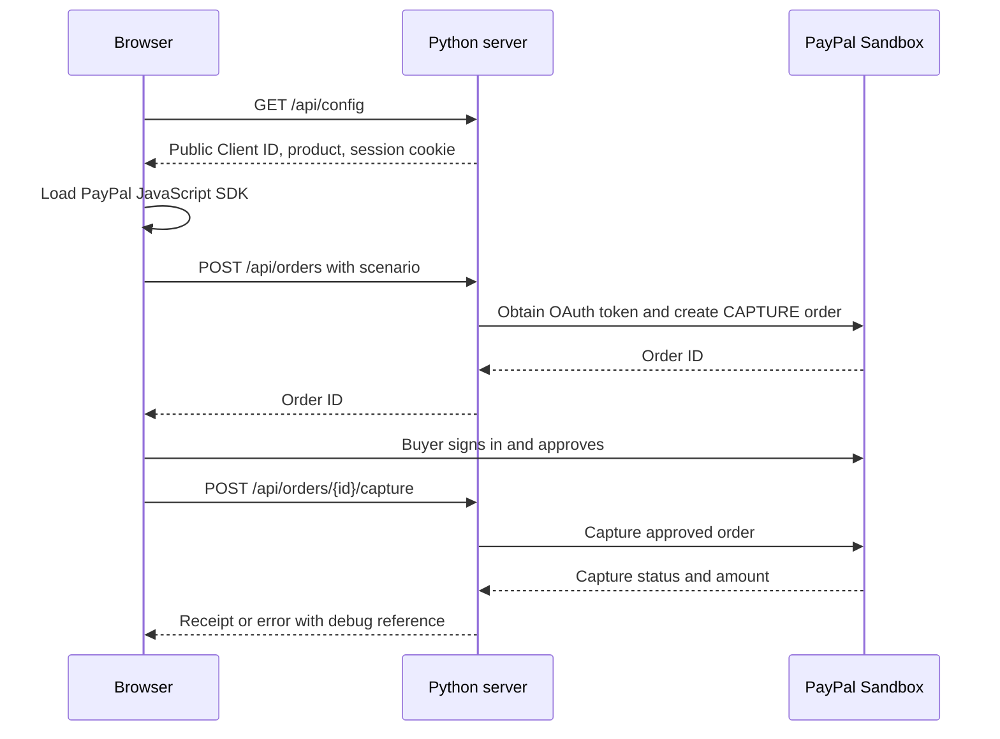

# Historical retail development guide

Archived when publishing the workshop Slice 1 branch. This describes the earlier retail demo, not current workshop behavior. See [current development guide](../DEVELOPMENT_GUIDE.md), [branch map](../BRANCHES.md), and [Slice 1 review](../SLICE1_REVIEW.md). The previous uncommitted planning link is preserved below.

For proposed hackathon concepts and the coding principles to carry into future development, see [Product direction](../PRODUCT_DIRECTION.md). Those ideas are planning proposals, not current app features.

## What has been built

This is a local PayPal Sandbox checkout demonstration for the fictional Trail Supply product, **Weekend explorer kit**, priced at **$25.00 USD**. It uses Python 3.10+ and the standard library on the server, with plain HTML, CSS, and JavaScript in the browser. There is no Node.js requirement, package installation, database, or frontend build step.

Implemented behavior:

- Create a PayPal order on the server with a fixed price and currency.
- Open PayPal checkout so a Personal Sandbox buyer can approve the order.
- Capture the approved order on the server and display a receipt with order ID, capture ID, and status.
- Show success only when the capture status is `COMPLETED`.
- Force `INSTRUMENT_DECLINED` at capture using a Sandbox mock header.
- Handle cancellation and failures, displaying PayPal's debug reference when available.
- Run a clearly labeled simulation without credentials or PayPal API calls.

This app uses test money and does not ship products. It is not a production payment service.

## Verification status at handoff

During initial development, all **seven automated tests passed**, Sandbox OAuth authentication succeeded, and a real Sandbox order was created through the running app. The developer subsequently reported a payment visible in the user dashboard after switching to a US buyer account.

The automated tests mock PayPal; they do not prove a live Sandbox checkout works. Still confirm the `COMPLETED` receipt and the seller's activity during your own setup. The real forced-decline flow and cancellation should also be manually verified; completion of those checks was not reported at handoff. Automated browser and visual verification was unavailable during development.

## First-time setup

1. Clone the repository and open a terminal in its root.
2. Check `python --version`; use Python 3.10 or newer.
3. Copy `.env.example` to `.env` **only if `.env` does not already exist**:

   ```powershell
   Copy-Item .env.example .env
   ```

4. Enter your **Sandbox app's** Client ID and Secret in `.env`. These are not buyer or seller login credentials:

   ```dotenv
   PAYPAL_CLIENT_ID=your_sandbox_client_id
   PAYPAL_CLIENT_SECRET=your_sandbox_client_secret
   PORT=8000
   ```

5. Save the file and start `python server.py`.
6. Open `http://localhost:8000`. Use the URL's configured port if you changed `PORT`.

For a UI-only walkthrough, leave both credential fields empty and click **Try simulated checkout**. That button is also available when real Sandbox checkout is configured. A simulated receipt is not evidence of a PayPal transaction.

After changing `.env` or Python code, stop the server with **Ctrl+C** and start it again. Refresh the page after browser code changes. Existing process environment variables take precedence over `.env` because the loader uses `os.environ.setdefault`; check terminal environment settings if a saved change appears ineffective.

## Accounts: which credentials go where?

| Account or credential | Purpose | Where it is used |
| --- | --- | --- |
| Real PayPal developer login | Manage Sandbox apps and accounts | Developer Dashboard |
| Business Sandbox account | Seller receiving test payments | App association and seller activity |
| Sandbox app Client ID and Secret | Authenticate the server | Local `.env`; Client ID is also public in the browser SDK |
| Personal Sandbox email and password | Buyer approving test payments | PayPal checkout window or `www.sandbox.paypal.com` |

You do not need to sign in to Sandbox before clicking checkout. The buyer should be distinct from the seller. No account password belongs in `.env` or application code.

### Country pitfall encountered during development

The initial buyer and seller were both **IN (India)**. Credentials authenticated and order creation worked, but the checkout window showed a generic error. Direct Sandbox login also worked. A newly created **US Personal Sandbox buyer** subsequently worked with the existing **IN Business seller**, without changing app credentials.

PayPal states that Indian accounts cannot receive domestic payments and can receive international payments. This makes the India-to-India restriction a likely explanation for the original failure, although the generic popup did not establish the cause. See [PayPal's India payment policy](https://www.paypal.com/in/cshelp/article/can-i-use-paypal-to-receive-payments-from-indian-customers-help1049).

For this demo, use the tested **US buyer → IN seller** pairing. Create the US Personal test account under **Developer Dashboard → Sandbox Accounts → Create Account**. Its country setting describes the test account, not your actual location. Sign out of other Sandbox sessions or use a private window to select the intended buyer.

## How the payment flow works



**Approval is not capture.** The `onApprove` callback calls our server, which captures the order. Do not display success just because the buyer approved or the popup closed.

| File | Responsibility |
| --- | --- |
| `server.py` | Environment loading, OAuth, PayPal API calls, session ownership, price, capture checks, HTTP routes |
| `public/index.html` | Checkout markup, status region, progress steps, receipt |
| `public/style.css` | Responsive layout and styling; optional Google Fonts import |
| `public/app.js` | SDK loading, create/approve/cancel callbacks, API requests, scenario selection, simulation |
| `tests/test_checkout.py` | Mocked payment behavior and local HTTP tests |
| `.env.example` | Empty credential template safe to commit |
| `.gitignore` | Excludes `.env`, Python caches, and virtual environments |
| `README_setup_guide.md` | Detailed Sandbox account setup reference |

| Route | Behavior |
| --- | --- |
| `GET /api/config` | Sets a session cookie and returns public configuration; never the Secret |
| `POST /api/orders` | Accepts `scenario: success` or `decline`; price always comes from the server |
| `POST /api/orders/{id}/capture` | Captures an order belonging to the same browser session |

Writes require a matching browser `Origin` and session cookie. Direct API tests must first obtain the cookie from `/api/config`, then send both headers. The server binds only to `127.0.0.1`; access from another machine is not supported by this setup.

## Testing your changes

```powershell
python -m unittest discover -s tests -v
```

The seven tests cover fixed server pricing, stable capture request IDs after a failure, cached capture responses, session ownership, decline issue/debug reference, the real adapter's mock header, HTTP flow and Secret privacy, origin rejection, and static route restrictions.

Perform these manual checks with a US Personal buyer:

| Scenario | Expected result |
| --- | --- |
| Successful payment | Approve checkout; receive a `COMPLETED` receipt; confirm capture in seller activity |
| Payment method declined | Approve checkout; capture returns a decline message instead of success |
| Recovery after forced decline | Select Successful payment and start a new checkout; no forced decline |
| Cancel checkout | Cancellation message and no capture initiated by the cancellation callback |
| Simulated success/decline | Correct UI outcomes, labeled as simulation, no PayPal transaction |

The decline flag is stored when the order is created. Selecting another scenario does not change an existing order. Forced declines are intentionally not automatically restarted: restarting the same forced scenario would repeat the error.

## Troubleshooting

| Symptom | Check or action |
| --- | --- |
| Only simulation is available | Save both app credentials in `.env`, restart the server, refresh the page |
| Authentication fails | Use Sandbox app credentials, not live keys or account passwords; confirm app association with the seller |
| Generic PayPal popup error | Check buyer/seller countries and intended buyer session; test direct Sandbox login; try a private window |
| PayPal buttons do not load | Check Client ID, network access, and browser blockers; simulation can still work |
| `PAYPAL_UNAVAILABLE` | Check outbound HTTPS access to `api-m.sandbox.paypal.com`; a network failure does not prove credentials are invalid |
| `ORDER_NOT_FOUND` | Order expired, server restarted, or browser session changed; restart checkout in the same browser |
| Port already in use | Stop the existing demo or choose a different `PORT`, then restart |
| Capture failed after approval | Check seller activity before creating another order; a network timeout can leave the payment outcome uncertain |
| Capture status is not `COMPLETED` | Do not treat it as paid; inspect seller activity and reconcile the outcome |

The server prints PayPal issue codes and debug IDs. Share those references when debugging, without sharing passwords, Client Secrets, tokens, or full account details. The UI's “Sandbox connected” label means credentials are present, not that account eligibility or authentication has been verified.

## Development pitfalls and boundaries

- **Keep amounts on the server.** `PRODUCT` in `server.py` controls price/currency, while the HTML displays a hard-coded price. Update both and the tests when changing the product. Moving to multiple products needs server-side catalog validation.
- **Keep the Secret server-side.** Only the public Client ID goes to the SDK. Do not add credentials to JavaScript, documentation, test fixtures, screenshots, or logs.
- **Order state is in memory.** Restarting loses orders and capture request IDs. Orders expire after one hour; up to 500 unexpired orders are retained. There is no persistent receipt history.
- **Capture retries have limited protection.** The same stored request ID is reused when capture is retried during the process lifetime. The UI does not automatically retry; create-order calls do not deduplicate separate clicks into one order. Do not assume durable exactly-once processing.
- **Non-completed capture responses are also cached.** Repeated capture calls return the stored result; this app does not poll for a later status. Add reconciliation before relying on pending outcomes.
- **Sessions are not authentication.** A session cookie only links a browser to its local order. There are no user accounts or authorization roles. Orders and OAuth calls are serialized by a shared lock, suitable only for this small demo.
- **Sandbox is fixed in code.** Replacing keys alone does not convert this app into a production integration. There are no webhooks, refunds, subscriptions, tax/shipping calculations, fulfillment, persistent idempotency, or monitoring.
- **Do not publicly deploy the standard-library server as-is.** Production needs durable order storage, HTTPS, authentication as appropriate, verified webhooks, reconciliation, and a reviewed deployment configuration.

## Git and handoff hygiene

Before committing, run:

```powershell
git status --short
git check-ignore .env
git diff --cached --stat
```

`.env` should be ignored and absent from staged changes. Never use `git add -f .env`. Each coworker creates their own local file or obtains approved credentials through a private channel. If a Secret is ever published, rotate it; removing it in a later commit does not erase exposure.

The repository's published `master` history was reset to the project's own initial commit. A local `original-history-backup` branch was retained on the original development machine. Do not publish it with `git push --all` or merge it into `master` unless restoring inherited history is intentional.

Useful next development steps are durable order storage and payment reconciliation, then improvements to product configuration and browser testing. Keep those separate from the working Sandbox checkout so failures remain easy to isolate.

Further references: [PayPal standard checkout integration](https://developer.paypal.com/studio/checkout/standard/integrate), [Sandbox accounts](https://developer.paypal.com/sandbox-testing/accounts), and the repository's [setup guide](../../README_setup_guide.md).
